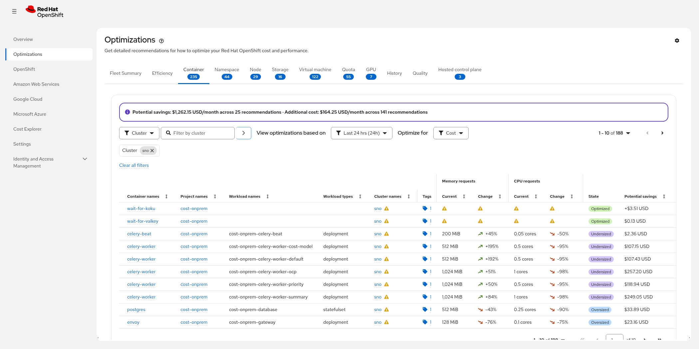
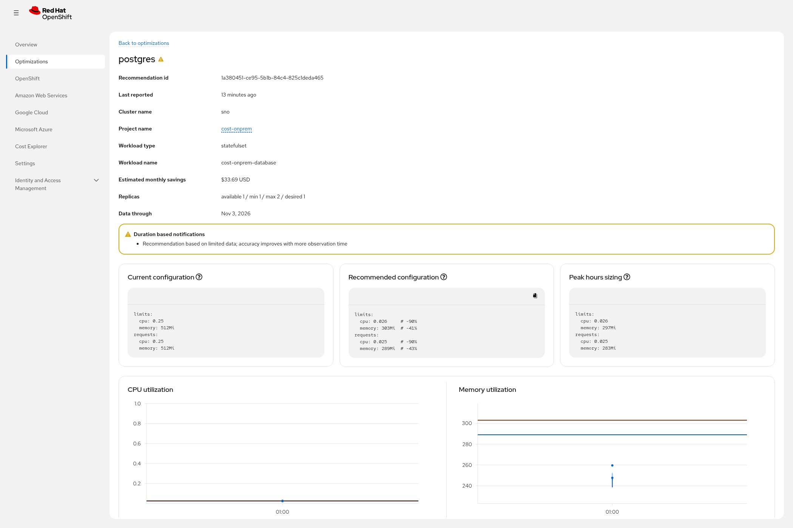

<!-- _class: lead -->

# Resource Optimization for OpenShift

## Right-size every workload with recommendations you can explain

**Cost Management Optimizations · as of November 2026**

---

## Your cluster asks for more than it uses — and nobody has time to check

Over-provisioning is the safe default, and it is also the most common source of avoidable spend.

- Requests and limits are usually set once, guessed once, and never revisited
- Every resource type needs a different answer: containers, namespaces, nodes, GPUs, storage, snapshots, quotas, virtual machines
- Manual review does not scale past a handful of namespaces — and it says nothing about *why* a number is right
- Under-provisioning has its own cost: throttling, evictions, and incidents nobody attributes to sizing

The result is a cluster that costs more than it should and still has workloads that are too small.

---

## What you get: right-sizing across eight resource types

One place that answers "what should this be sized at?" for the whole estate, not just containers.

### Compute
Containers and namespaces: CPU and memory requests and limits, with idle and abandoned workloads flagged separately.

### Infrastructure
Nodes, GPUs and storage: consolidation, GPU profiles, and volume capacity from growth trends.

### Governance
Quotas, virtual machines and snapshots: quota targets, VM sizing, and snapshots that no longer earn their cost.

Each recommendation arrives with **two perspectives** — one tuned to cost, one to performance headroom — across containers, namespaces, nodes, virtual machines and hosted control planes.

Hosted control planes get their own view: how much control plane each hosted cluster needs, and how many more hosted clusters a management cluster can take.

---

## Where you find it

Recommendations live in the Optimizations area of Cost Management — the console your teams already use.

Example data from a demonstration cluster: the container tab with a savings summary, per-row recommended changes, and a state for each workload.

---

## Recommendations come with a monthly number

Savings are calculated from the rates you already configured — not from a generic list price.

- Every recommendation carries a **monthly dollar impact**, so a team can rank work by value, not by volume
- Estimates use the rates set in Cost Management, including your own cost model
- A fleet rollup shows potential savings and additional cost side by side, split by resource type

<strong>Example from a demonstration cluster:</strong> $1,262.15 per month of potential savings across 25 container recommendations, alongside $164.25 per month of additional cost recommended for 141 workloads that are sized too small.

Numbers like these are illustrations of the product's output, not a benchmark of your estate.

---

## Sized for how the cluster actually runs

For clusters that follow a business schedule, sizing should follow the schedule — not the calendar day.

**All hours**

The default view: what a workload needs across the full 24-hour day, seven days a week.

Applies to every cluster, scheduled or not.

**Peak hours**

For clusters with a defined weekly schedule, detail pages add a second view computed from the hours you actually operate.

Lists and history stay all-hours, so the two views never disagree about a number without saying so.

A schedule is configured per organization, per cluster, or per namespace, with a timezone and weekly windows.

---

## The whole estate, one place

Every resource type has its own view, so nobody has to translate a container recommendation into a node decision.

| View | Answers |
|---|---|
| Fleet Summary | How is the fleet doing, and where should we look first? |
| Containers, namespaces | What should these workloads request and limit? |
| Nodes | Do we have the right number and shape of nodes? |
| Storage | Which volumes are oversized, near full, or orphaned? |
| Quotas | Are team quotas too tight, too loose, or just right? |
| Virtual machines | What should these VMs be sized at, and are they idle? |
| GPUs | Which GPU workloads are idle, memory-bound, or need a different profile? |
| Hosted control planes | How much control plane does each hosted cluster need, and how many more can this management cluster host? |
| History, Quality | How have recommendations changed, and how well are teams adopting them? |

---

## Understand *why*, not just *what*

A recommendation a team cannot explain is a recommendation a team will not apply.

- Current and recommended configuration sit **side by side**, with a peak-hours view where a schedule applies
- The percentile bands and the trend are visible, not just the final number
- Plain-language notifications say what qualifies the advice — including when there is not yet enough data to be confident
- The usage window is stated, so a decision can be reviewed months later

---

## How it works: your existing pipeline, one step further

No new agents, no second data pipeline, no copy of your cluster in someone else's store.

### 1 · Collect
The operator you already run collects cluster metrics and packages usage reports.

### 2 · Analyze
Usage data is rolled up into compact per-day summaries — percentiles computed once, at ingest.

### 3 · Recommend
Purpose-built engines turn those summaries into sizing advice, served to Cost Management and to the API.

Recommendations are recalculated as new reports arrive, so the guidance tracks reality instead of a one-off audit.

---

## Advisory by design

Nothing is changed without a human deciding to change it.

- The engine contains no Kubernetes client: it never patches, scales, or schedules anything
- Recommendations are served through an API; your teams, pipelines, or GitOps process decide what to apply
- Every recommendation is traceable to the usage window it came from, so a decision can be reviewed later

That separation is deliberate: sizing advice and runtime automation are different jobs, done by different tools.

---

## It complements the tools you already run

Queueing, autoscaling and device allocation decide <em>when</em> work runs; this decides <em>what size</em> that work should be.

| Your tooling | What it does | How recommendations help |
|---|---|---|
| Kueue | Queues and schedules batch jobs against quota | Correct requests make quota meaningful; inflated requests hoard it |
| KEDA | Scales replicas from events | Sizing tells you what each replica should ask for |
| DRA | Allocates devices such as GPUs | GPU recommendations show which workloads need a device at all |
| HPA / VPA | Adjust replicas or requests at runtime | Recommendations give the starting point those controllers assume |

None of these tools computes a workload's steady-state size from historical usage — that is the gap this fills, and its output feeds them.

---

## Roadmap: what is planned

The roadmap is about depth per resource type and about running closer to your clusters — not about adding another dashboard.

| Direction | Status |
|---|---|
| More resource types: JVM and Go runtime guidance, autoscaler (HPA/VPA) recommendations, replica-count guidance, network | Planned or under consideration |
| MachineSet tier recommendations, building on existing node advice | Planned |
| Deployment closer to the cluster, for disconnected or latency-sensitive environments | Under consideration |
| Positioning and interoperability with scheduling and autoscaling projects | Documented publicly, evolving |

Items here are planned or under consideration. This deck makes no dated commitment.

---

<!-- _class: lead -->

# Next step

## Open Optimizations in Cost Management and look at the container tab

Then pick one namespace and compare its recommendations with what the team believes it needs.

**A rightsizing review of your estate** — one session, your numbers, no changes applied.
