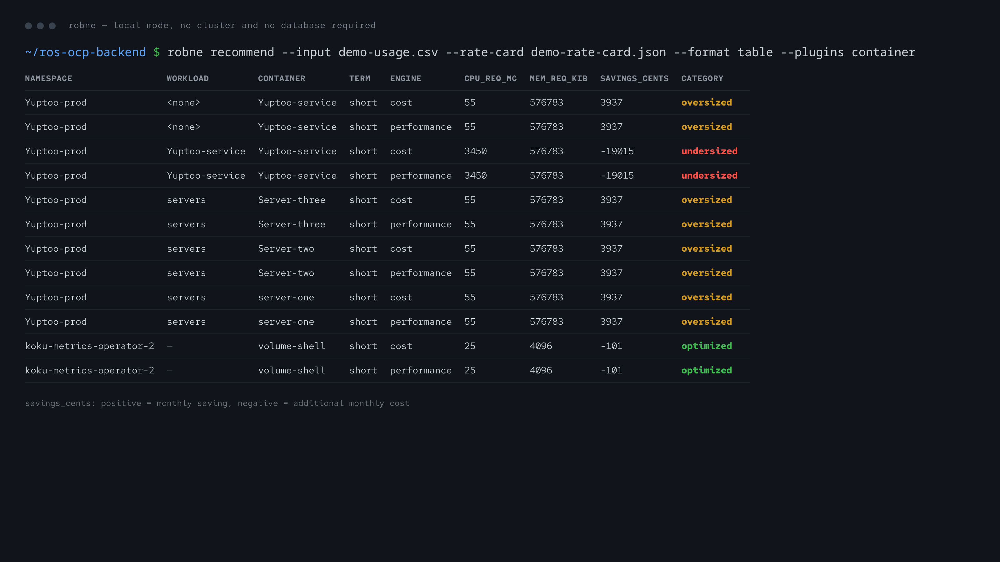
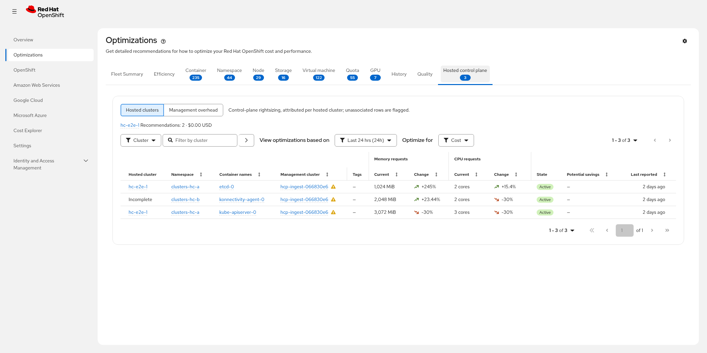
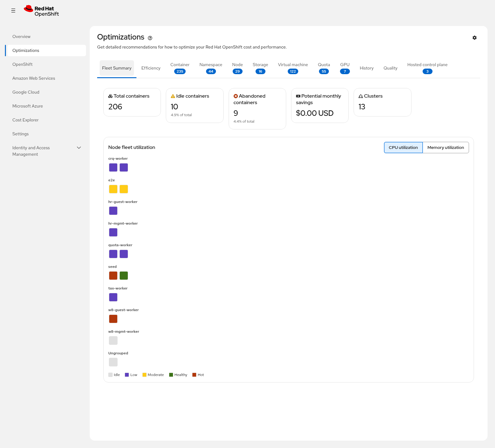

<!-- _class: lead -->

# State of the Native Engine

## ROS-OCP backend — engineering briefing

**as of 2026-11-03** · ~20 min + live demo

<span class="small">Every number in this deck resolves to a row in `docs/facts.md`, with a source and an as-of date. Numbers that do not are marked *asserted, not verified*.</span>

---

## One-year arc: glue layer → engine → service → CLI → operator

| Stage | What changed | Where it lives |
|---|---|---|
| **Glue layer** | Kruize consumer: parse CSV, push to Kruize, reshape its output | gone |
| **Engine** | Native percentile engines behind the same REST contract (ADR-0001) | `internal/engine/` |
| **Service** | Savings, idle/zombie, business hours, HCP, quality and history surfaces | `internal/api/`, `internal/services/` |
| **CLI + library** | `robne` for offline runs; `librobne` as the embeddable core | `cmd/robne`, `librobne/` |
| **Operator** | On-cluster Local/Hybrid modes — **future work, not implemented** (#138) | separate repo |

<span class="small"><!-- as of 2026-11-03 --> The engine, service and CLI stages are shipped; the operator stage is a contract, not code.</span>

---

## What's new since the last state-of (2026-10-05)

- **HCP fleet-capacity advisory** — two endpoints, five native scenarios, MCE reference gauges (#392)
- **Request-less containers ingest** — empty request cells now parse as 0 with usage preserved instead of dropping the row (#697, ADR-0344)
- **HCP management topology** — explicit `management` boolean on rows (#695), native-first HCP detail parity (#696)
- **Savings rollup** — `savings-summary` now splits savings from additional cost per plugin (#686)
- **v15 hardening landed** — settings-write denial (#751), RBAC scope (#753), heatmap scope (#754)
- **Compatibility list window fixed** — the legacy container list alias now uses the documented current-month window (#782)
- **Plugin count** — 12 registered in code; the public domain table lists 10

<span class="small"><!-- as of 2026-11-03 --> Source: `CHANGELOG.md` Unreleased, `internal/plugins/plugins.go`, `docs-site/index.md`.</span>

---

## Why Kruize had to go

Kruize 0.11's own published scalability run, against the native engine's 100K run —
both from the same benchmark report.

| Metric | Kruize 0.11 | Native (100K run) |
|---|---|---|
| Containers | 5,000 (15 days of data) | ~84,000 (31 days) |
| Processing wall time | 3h 17m | ~87 min |
| Replicas | 10 | 1 |
| Peak memory | 43.52 GB | 119 MiB steady in-run |
| Database | 22 GB | 3.5 GB |
| Stored results | 7.2M individual entries | daily digests |
| GPU containers | separate 5h 50m run | same pipeline, +~27 s |

<div class="callout">Production snapshot (SaaS, 24 h, July 2026): 3 Kruize replicas, <strong>99.6%</strong> experiment-creation failure rate, <strong>73%</strong> result-update failure rate.</div>

<span class="small">Different deployments, not equal footing: the Kruize column is its own published scalability run in the shape it runs in production — multi-node OpenShift, 10 replicas, 5,000 containers × 15 days. The native column is one single-node OpenShift on a lab Dell R640 (8 cores, 78 GB, a virtualized 2018-era Xeon host), 1 pod, fed direct-to-MinIO.</span>

<span class="small"><!-- as of 2026-07-11 --> `docs-site/operations/scale-benchmark-report.md`</span>

---

## The decision

**Requirements the replacement had to meet**

- One engine inside the existing Koku pipeline — no second datastore, no second upload path
- Same REST contract, so the UI keeps working while the engine changes underneath
- Percentiles computed once, at ingest, stored as compact daily digests
- A plugin boundary, so a new resource type does not mean a new service
- Runs without a JVM; runs offline for support and field work

**What we deliberately did not do**

- Not a Kruize fork, not a sidecar next to Kruize, not a re-implementation of the Kruize API in Go
- Not a second copy of the customer's data — the engine reads the same Postgres and the same CSVs
- Not a replacement for `koku`, `koku-ui` or the operator; ROS stays the recommendation layer

---

## Coverage: 12 plugins, 10 public domains

| Plugin | What it recommends | Engines | Terms |
|---|---|---|---|
| container | CPU/memory requests and limits, inline idle/zombie | cost + perf | 3 |
| namespace | namespace-level quota targets from container recs | cost + perf | 3 |
| node | under/over-provisioned nodes, consolidation, target sizing | cost + perf | 3 |
| vm | vCPU/GiB, disk, I/O, instance type, guest GPU, idle/abandoned | cost + perf | 3 |
| hcp | hosted control-plane sizing, fleet capacity, advisories | cost + perf | 3 |
| gpu | MIG profiles, time-slicing replicas, classification | single | 3 |
| pvc | capacity from growth trends: oversized, near-full, orphaned | single | 3 |
| quota | ResourceQuota tighten/raise/optimal | single | 3 |
| cluster-quota | ClusterResourceQuota pools vs namespace quotas | single | 3 |
| snapshot | orphaned, stale, redundant, never-restored snapshots | single | 3 |

<span class="small"><!-- as of 2026-11-03 --> `slo` and `kruize` are registered in code as well but are not in the public domain table (`docs-site/index.md`). Term windows are user-configurable per plugin and term — 1–90 days for most plugins, 1–365 for PVC — with the cap declared per plugin in code, not derived from retention.</span>

---

## Performance now

| Claim | Value | Status |
|---|---|---|
| 100K run: recommendations produced | 525,044 | verified |
| 100K run: processor wall time | ~87 min, 1 pod | verified |
| Steady memory during that run | 119 MiB | verified |
| Database size after that run | 3.5 GB | verified |
| API page-1 latency | < 100 ms | asserted |
| Deep pagination with keyset | < 500 ms | asserted |
| Cold start | < 1 s | asserted |
| Typical RAM | 50–100 MiB | partially verified (119 MiB steady is sourced) |
| Keyset vs offset page selection | ~1000× faster | asserted |

<span class="asserted"><!-- as of 2026-11-03 --> The four asserted rows have no source in the repo: they survived from the previous deck. They need a measurement run before anyone quotes them outside this room.</span>

---

## Scale benchmark: what the run proves, and what it cannot carry

<div class="cols">
<div>

**The run proves**

- ~84,000 containers, ~2,500 VMs, ~2,500 GPU containers, ~12,000 PVCs, plus quotas and snapshots
- 525,044 recommendations from one pod in ~87 minutes
- 3.5 GB database, 119 MiB steady memory
- GPU work folded into the same pipeline (+~27 s), not a separate run

</div>
<div>

**It cannot carry**

- A production SLO: the run points at MinIO directly, so the Koku listener is bypassed
- End-to-end wall time: ~56 min of upload harness and ~5.3 h of data generation are excluded
- A claim about current code: the phase-17 dual-stream business-hours re-run is still open (#518)
- A claim about production hardware: one SNO on a lab Dell R640, 8 cores and 78 GB RAM

</div>
</div>

<div class="callout">Quote it as: <strong>one pod, ~87 minutes of processor time, 525,044 recommendations over ~84,000 containers</strong>. Not "87 minutes end to end", and not "production".</div>

<span class="small"><!-- as of 2026-11-03 --> `docs-site/operations/scale-benchmark-report.md` (frozen 2026-07-11), #518</span>

---

## Governance

| Mechanism | State |
|---|---|
| Architecture decision records | 343 files, newest ADR-0352 |
| ADR index | `docs-site/architecture/adrs.md` — every ADR summarised for readers |
| Adversarial reviews | v14 → v15 (29 findings), each shipped as tracked issues |
| CI gates | unit + short suite, lint, docs lint/drift, OpenAPI changelog check, govulncheck, CodeQL (main-only) |
| Public contracts | `docs-site/` pages carry `Last verified` dates; the API page is generated from `openapi.json` |

<span class="small"><!-- as of 2026-11-03 --> `docs/adr/` listing, `.github/workflows/`.</span>

---

## Local mode: the same engine, no cluster

<div class="cols">
<div>

**`robne` CLI**

- Reads a ROS CSV, a directory, a tarball, or a Postgres digest table
- Emits JSON, CSV or a table; `--rate-card` for dollars
- No JVM, no PostgreSQL required for a CSV run

**`librobne`**

- The engine as an importable Go module
- `Recommend*` produces, `Apply*` folds decisions back
- Same code path as the service — not a re-implementation

</div>
<div>



</div>
</div>

<span class="small"><!-- as of 2026-11-03 --> Real output: `robne recommend` over `scripts/samples/ros-ocp-usage.csv` with a demo rate card. Both engines, same input, no cluster.</span>

---

## Demo hand-off: one engine, every surface

**In the UI** — Optimizations area of Cost Management

1. Fleet Summary → Container list with savings
2. Namespace / Node / Storage / Virtual machine / Quota / GPU tabs
3. History and Quality tabs, then one detail page (bands, gauges, notifications)

**Then on the CLI** — the same containers, the same percentiles, no cluster

```bash
robne recommend --input demo-usage.csv --rate-card demo-rate-card.json \
  --format table --plugins container
```

<div class="callout">
Known issue before the demo (<strong>#790</strong>): the Optimizations cluster filter sends the cluster's <em>display name</em>, and five endpoints bind that value straight into a <code>uuid</code> column — Node, Storage, Quota, Cluster quota and Snapshot answer <strong>503</strong> until the filter resolves aliases server-side. Pick the cluster by UUID on those tabs.
</div>

---

## robne-operator: a contract, not code

| | |
|---|---|
| Status | **Future work, not implemented** (#138) |
| Where | A separate operator repo, modeled on koku-metrics-operator |
| CRD | `ResourceOptimizationConfig` (`resource-optimization.openshift.io/v1beta1`) |
| Modes | **Local** (on-cluster engine + local API), **Remote** (collector/uploader), **Hybrid** (local engine, push recs + daily summaries) |
| Import rules | `librobne` only — never `csv`, `pgrec` or `pgdigest` |
| Engines | PromQL → daily digests → `Recommend*` → operator's own store |

<span class="small"><!-- as of 2026-11-03 --> `docs/features/local-mode.md` ("Status: Future work"), `docs-site/architecture/librobne.md` §robne-operator.</span>

<span class="small">Say it out loud in the room: nobody should leave thinking an operator image exists today.</span>

---

## Roadmap

**Shipped since the last state-of**

- HCP advisory surfaces W2/W3/W5/W8 — served today, one advisory per hosted cluster per window; the W8 sleep advisory still owes its lab verification

**Next**

- `robne-operator` Local/Hybrid modes (#138) — a contract today, no operator image
- Performance testing with the Perf & Scale team, already in flight

**After that**

- MachineSet tiers: Tier 1 from node recs, Tier 2 from a cloud instance catalog
- Seasonality / proactive recommendations
- Phase-2 plugins: java/JVM, Go runtime, HPA and VPA advisories
- SaaS cutover plan for the native engine

**Housekeeping that blocks trust**

- Re-run the 100K benchmark on current code (#518)
- Close out the remaining v15 findings (#780)
- Fix the alias-filter 503 (#790) so the UI is demo-safe

---

## Summary: how the native engine compares with Kruize

**On Kruize 0.11's own published run**

- **Many more recommendation types** — Kruize ships container, namespace, GPU-container and JVM/Java advice; the native engine adds 15+ it marks absent: node, VM, PVC, cluster quota, GPU MIG, GPU time-slicing, GPU idle, container/namespace/node idle, business hours, data decay, savings, snapshot staleness, dual cost/performance engines
- **Much lighter** — 1 pod, 119 MiB steady, 3.5 GB database, against 10 replicas, 43.52 GB peak and 22 GB
- **Much faster** — ~84,000 containers and 525,044 recommendations in ~87 minutes, against 5,000 containers in 3 h 17 m

<span class="small">Caveat that travels with the comparison: the native side is one lab SNO (8 cores, 78 GB) fed direct-to-MinIO; the Kruize side is its own published run, not a re-run on our hardware.</span>

---

<!-- _class: lead -->

# Appendix

## Q&A jump targets

| If the question is about… | Go to |
|---|---|
| one plugin's behaviour (percentiles, classification, thresholds) | A1 · Domain detail |
| the plugin phases, and what is planned per plugin | A2 · Plugin phases |
| what an HCP advisory verdict means, and which wave added it | A3 · HCP advisory verdicts |
| the Hosted control plane tab itself | A4 · lab capture |
| the Fleet Summary heatmap | A5 · lab capture |
| settings writes, RBAC scope, tenant isolation | A6 · Security and operational controls |
| where to read further (docs-site, ADRs, specs) | A7 · Pointers |

---

## A1 · Domain detail

| Plugin | Notable behaviour | Public page |
|---|---|---|
| container | P95/P99 + adaptive margins, OOM-aware bumps, tag filtering | `features/container-recommendations.md` |
| namespace | digest band aggregation (p50/p95/p99/max) with growth buffers | `features/namespace-recommendations.md` |
| node | stranded-resource detection, consolidation, target sizing | `features/node-recommendations.md` |
| vm | instance-type matching, NUMA and placement checks, guest agent confidence | `features/virtual-machines.md` |
| hcp | namespace→hosted-cluster association, advisories, fleet capacity | `features/hosted-control-plane.md` |
| gpu | MIG profiles, time-slicing, catalog-driven | `features/gpu-mig.md`, `features/gpu-time-slicing.md` |
| pvc | growth projection, orphaned/near-full classification | `features/pvc-rightsizing.md` |
| quota / cluster-quota | tighten/raise/optimal against rec aggregates | `features/quota-recommendations.md`, `features/cluster-resource-quota.md` |
| snapshot | staleness classes with recoverable cost | `features/snapshot-staleness.md` |

---

## A2 · Plugin phases and what comes next

| Phase | Purpose | Plugins |
|---|---|---|
| Produce | generate recs from metrics and digests | container, namespace, node, gpu, pvc, quota, cluster-quota, snapshot, vm, kruize (legacy) |
| Enrich | annotate Phase 1 output | *future:* java, golang, python, nodejs, hpa, vpa |
| Optimize | cross-entity aggregation needing a fleet view | hcp, fleet-capacity surfaces |

<span class="small">Every plugin embeds `BasePlugin` in phase 1 with priority 50 unless it needs different ordering. Source: `docs-site/architecture/plugin-phases.md` (verified 2026-08-05).</span>

---

## A3 · HCP advisory verdicts (served surface)

<span class="small">What this is: the four verdict strings the HCP advisories endpoint can return, the wave that introduced each, and the condition it reports. Sizing lives on the Hosted control plane tab (A4); this is the advisory vocabulary.</span>

| Verdict | Wave | Means |
|---|---|---|
| `do_not_add_workers_first` | W2 headroom | hosted API latency and control-plane saturation say add workers first |
| `review_unused_hosted_cluster` | W3 zombie | cluster looks unused while its control plane keeps costing |
| `tune_noisy_webhook` | W5 API-tax | a webhook storms the shared API plane (management-scoped, no hosted id) |
| `schedule_nonprod_sleep` | W8 sleep | both gates pass: a declaration and a usage signature; the advisory never acts |

<span class="small">`GET /recommendations/openshift/hcp/advisories` serves one advisory per hosted cluster per window, unpaginated with a 500-row cap; rows expire per the correlator's `expiry_h`. Field vocabulary evolves additively only (ADR-0349).</span>

---

## A4 · The Hosted control plane tab (lab capture)



<span class="small">Lab cluster: `hc-e2e-1` is a test hosted cluster on a test management cluster, and one row reads "Incomplete" because association is missing. Test names make this slide internal-only. What to notice: the tab separates hosted-cluster sizing from the management-overhead scope, and both savings columns show `–` where no rate applies.</span>

---

## A5 · Fleet Summary heatmap (lab capture)

<div class="cols">
<div>



</div>
<div>

Lab fleet of 13 clusters, test clusters included — **internal only**. Two things worth saying out loud:

- The potential-savings tile reads <strong>$0.00</strong> while the per-cluster list shows <strong>$1,262.15/month</strong> for cluster `sno`: the two use a different rate basis. Observed, not yet traced in code.
- The heatmap has no cluster filter, so it shows every cluster the org can see — including test clusters nobody would chase.

</div>
</div>

---

## A6 · Security and operational controls worth naming

- **Settings writes** stop at permission denial, before persistence (#751)
- **RBAC scope** is resolved per request; caches are scope-free (ADR-0352)
- **Heatmap reads** are scope-checked, not org-wide (#754)
- **Unauthorized or unknown clusters** answer 200 with empty data — non-disclosing, not 403-with-existence
- **CSV download is SSRF-hardened**: host allowlist, private-network deny, 500 MiB default cap
- **Fleet-capacity responses** are `Cache-Control: no-store`
- **Idempotent writes** (`ON CONFLICT DO UPDATE`) let replicas overlap without corrupting state

<span class="small"><!-- as of 2026-11-03 --> CHANGELOG Unreleased, ADR-0352, `docs-site/operations/performance-reviews.md` §SSRF-hardened CSV download.</span>

---

## A7 · Pointers

| Need | Where |
|---|---|
| CLI spec and examples | `docs-site/features/robne-cli.md` |
| Library contract, import rules | `docs-site/architecture/librobne.md` |
| ADR index | `docs-site/architecture/adrs.md` |
| UI contract for every endpoint | `docs-site/ui-integration-guide.md` |
| E2E harness and current counts | `docs-site/testing/validating-native-engine.md` |
| Frozen scale benchmark | `docs-site/operations/scale-benchmark-report.md` |
| Ecosystem positioning (Kueue/DRA/KEDA) | `docs-site/architecture/ecosystem-comparison.md` |
| Facts behind this deck | `docs/facts.md` in `pgarciaq/robne-deck` |
